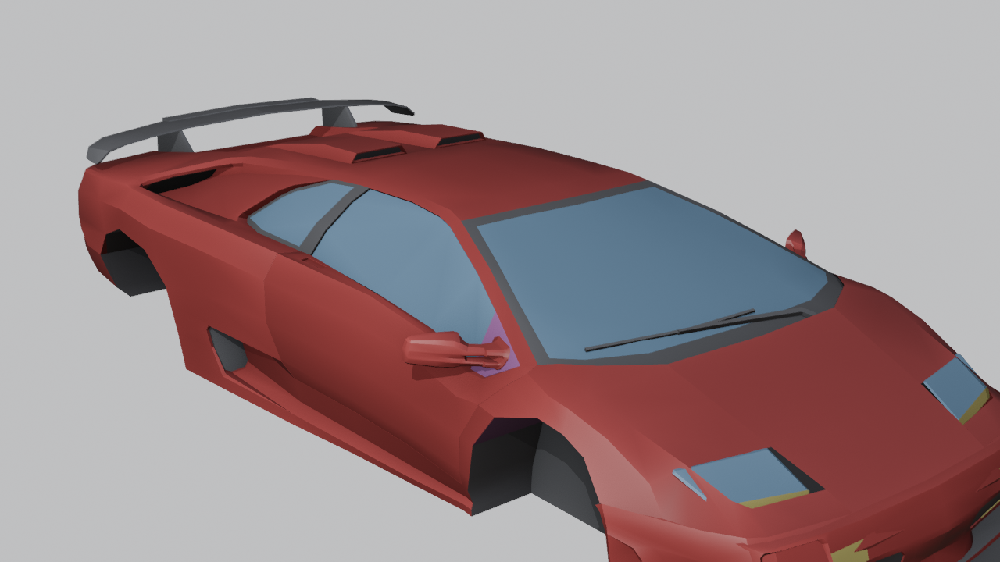
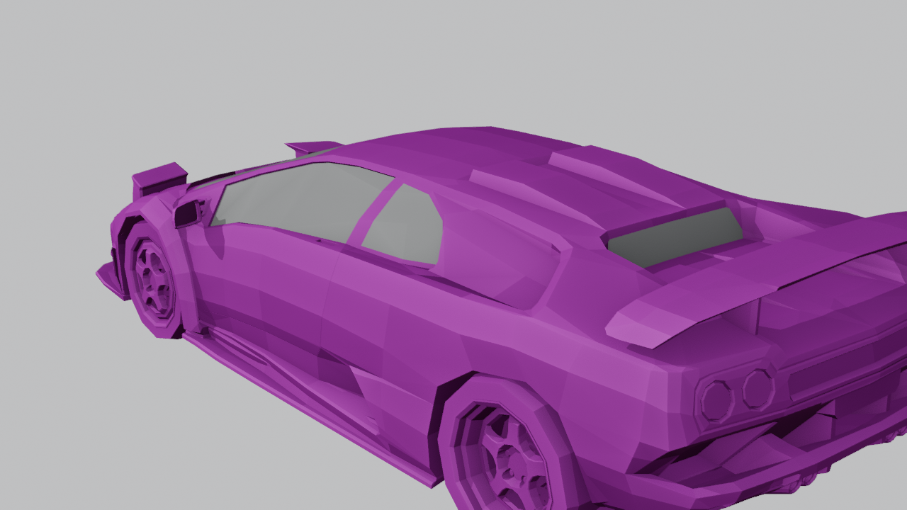
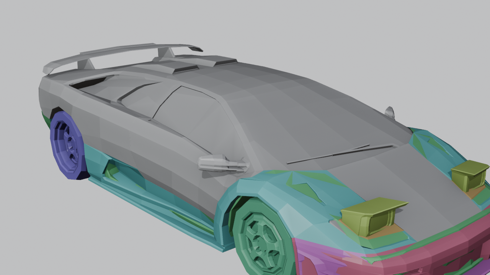
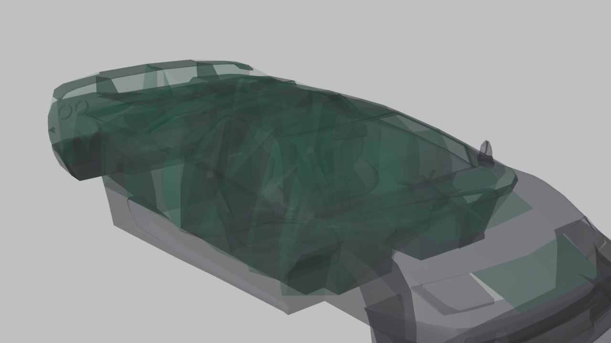
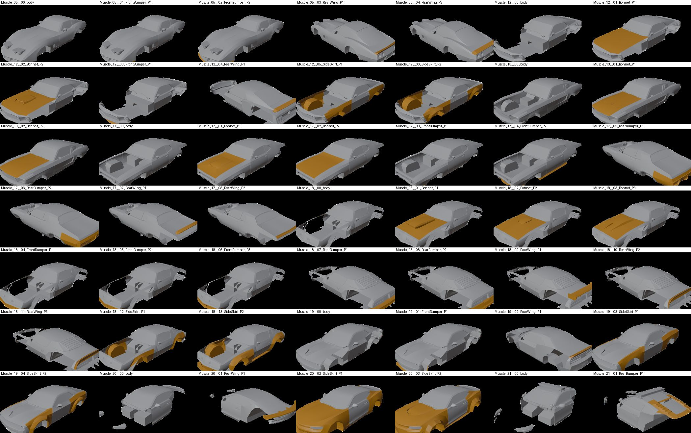
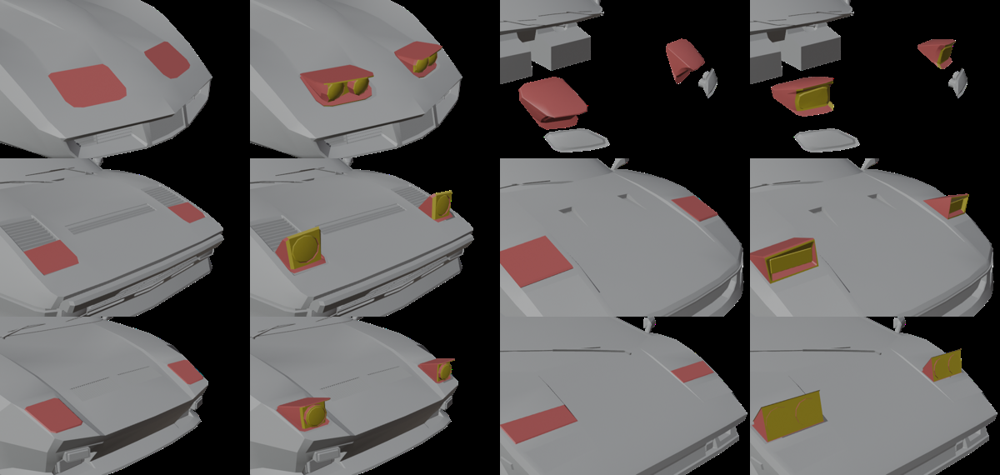
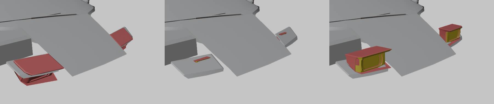

# mt-vehicle-factory

Turn a 3D car from an asset pack into a drivable, tunable **Motor Town** vehicle (UE 5.5), at scale.
These are the scripts and the method behind the 100+ cars of the DC ("Director's Cut") mod. Written
for modders doing it by hand and for AI agents doing it in bulk.



## What you get per car

- The body at its **real-world size**. The model is scaled to the length of the car it depicts.
- **Paint channels** the game can recolour, plus glass, head/tail/signal/reverse lamps, seats and dashboard, all on the game's own material slots.
- **Tuning parts** split out of the model: body kits, spoilers, hoods, bumpers and lips. The car is sold with its stock parts fitted.
- **Collision** that follows the body. Antennas and mirrors are left out, so they're walk-through. Every part has its own collision, as the game's parts do.
- **Wheels at the model's size**, suspension scaled to the car's real weight, engine placed front, mid or rear, and extra axles (6x6).
- **Pop-up headlights**, rigged and animated the way the game's Panther does it.
- Bikes: hand grips, rider pose (sport, upright or scooter).

## The pipeline

```
asset pack FBX
   │  factory/lpr_prep.py   (Blender)   merge pieces, scale to real length, tag wheels/axles/parts/pop-ups
   ▼
prep .blend
   │  factory/kit.py        (Blender)   material slots, paint detection, lamps, parts, collision hulls -> FBX
   ▼
kit/<car>/  SM_<car>_Body.fbx + parts/*.fbx + popup/*.fbx + info.json
   │  factory/popup.py      (Blender)   pop-up lamps -> skeletal mesh + LightOn animation
   │  editor/import_*.py    (UE editor) import meshes, sockets, collision, game material stand-ins
   ▼
UE project assets  /Game/DC/Vehicles/<Car>/...
   │  generator/kit_cars.py              per-car blueprint edits, table rows, parts, dealer bays
   │  generator/build_vehicles.py        clone a vanilla blueprint and table row, apply edits (MTBPInjector)
   │  generator/build_dc.sh              cook -> vehicles -> parts table -> bays -> pak -> deploy
   ▼
YourMod_P.pak
```

| Stage | Screenshot |
|---|---|
| 1. The pack model as shipped, with every alternative piece stacked |  |
| 2. Tagged: body, wheels per axle, parts, pop-up states |  |
| 3. Game slots: paint (red), glass (blue), lamps (yellow and red), trim |  |
| 4. Collision hulls (green) |  |
| 5. Tuning parts split out (orange) |  |
| 6. Pop-up headlights, closed and open |  |
| 7. Pop-up animation: closed, half, open |  |

## Start here

- **People:** [docs/MANUAL.md](docs/MANUAL.md), step by step from a pack car to driving it.
- **AI agents:** [docs/AI_AGENTS.md](docs/AI_AGENTS.md), the operating rules, the checks that catch silent failures, and what not to do.
- **How a Motor Town vehicle is built:** [docs/CONCEPTS.md](docs/CONCEPTS.md). Wheels, slots, parts, mirrors, pop-ups, seats, engine. Read it before changing anything.
- **Using Unreal Engine as the cooker:** [docs/COOKING.md](docs/COOKING.md). The empty project, stand-ins at the game's paths, import settings, the cook command, packing.

## Requirements

- Motor Town (UE 5.5 build) and its `.usmap` mappings
- Blender 4.5
- Unreal Engine 5.5 with an empty project to import and cook into (ours is called MTMapAddon). Enable Python Editor Script Plugin and Remote Execution.
- .NET 8 SDK for `tools/MTBPInjector` (blueprint and DataTable editor on [UAssetAPI](https://github.com/qxZap/UAssetAPI/tree/ue720))
- [repak](https://github.com/trumank/repak) to pack
- For the table step: the MoreTuning DataTableFramework (`MORETUNING_DTF`, `MORETUNING_REBASE`) and the build helpers from [Arini-MotorTown](https://github.com/qxZap/Arini-MotorTown) (`mt_paths.py`, `channels.py`)

## Settings (environment variables)

| Variable | Meaning | Default |
|---|---|---|
| `MTVF_WORK` | working folder: `factory/kit`, `fbx`, `tex`, manifests, editor jobs | `work` |
| `MTVF_REFS` | the per-car reference file | `data/kit_cars_refs.json` |
| `BLENDER` | blender.exe | Blender 4.5 default install |
| `UE_ROOT`, `UE_CMD`, `UE_PROJECT` | engine, `UnrealEditor-Cmd.exe`, your `.uproject` | |
| `MT_PAKS` | `Motor Town/MotorTown/Content/Paks` | |

## Not included

No asset-pack content. The meshes and textures are licensed and stay with whoever bought them. The
scripts read the pack from your own install. The generator files are the DC mod's own, so they use
its table names (`Vehicles_Biceps`, `VehicleParts_Biceps`); rename them for your mod.

## Credits

Built for the Arini island and the DC mod by qxZap and sati (co-author), with Claude (Anthropic) as the pipeline engineer.
